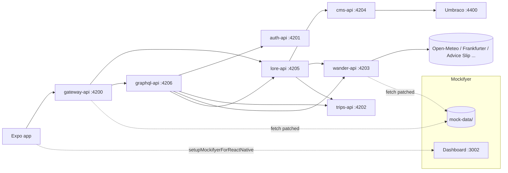

# Wanderweird: a friendly guide

> Wanderweird is a playful travel app built to show off **Mockifyer**. You log in, plan absurd trips to places like *Atlantis Boardwalk* or *Moon Base Brunch Bar*, check real weather and exchange rates, stamp a passport, and roll chaos dice. Behind it are seven small Node services, an Umbraco CMS, and Mockifyer, which records and replays every HTTP call they make.

Location: `example-projects/wanderweird-travel/` inside the `sgedda/mockifyer` monorepo.

> **About the side-by-side GIFs:** Most were recorded against the Expo **web** build on Metro port `8090` (so Atlas lives at `http://localhost:8090/mockifyer-atlas-live` there, not `8081`). Section 5.2 simulator recordings use the native Metro server on port `8081`. All recordings used the dashboard in proxy + SQLite mode with scenario `guide-demo-2`. Because the web build sends no hops of its own, a small local pass-through in front of the gateway was used as the root of each chain; that pass-through is not part of the example.

---

## Table of Contents

1. [What's inside](#1-whats-inside)
2. [How it works](#2-how-it-works)
3. [Quick start](#3-quick-start-about-5-minutes)
4. [Walkthroughs](#4-walkthroughs)
   - [4.1 Record real traffic](#41-record-real-traffic)
   - [4.2 Replay and edit a mock](#42-replay-and-edit-a-mock)
   - [4.3 Record a multi-service "hop tree"](#43-record-a-multi-service-hop-tree)
   - [4.4 Switch scenarios with client lanes](#44-switch-scenarios-with-client-lanes)
   - [4.5 The in-app Mockifyer dev menu](#45-the-in-app-mockifyer-dev-menu)
   - [4.6 Run everything in Docker](#46-run-everything-in-docker)
   - [4.7 Edit a mock over MCP](#47-edit-a-mock-over-mcp)
   - [4.8 Time travel: date overrides](#48-time-travel-date-overrides)
   - [4.9 A miss: record, then replay](#49-a-miss-record-then-replay)
   - [4.10 From bug report to fix](#410-from-bug-report-to-fix)
   - [4.11 Backend down: keep working from mocks](#411-backend-down-keep-working-from-mocks)
   - [4.12 Pair-debugging with a real AI agent over MCP](#412-pair-debugging-with-a-real-ai-agent-over-mcp)
   - [4.13 Asking an AI agent about your data (read-only)](#413-asking-an-ai-agent-about-your-data-read-only)
   - [4.14 Three data sets, one build](#414-three-data-sets-one-build)
5. [Tracing: see every hop, live](#5-tracing-see-every-hop-live)
   - [5.1 Turn tracing on in Wanderweird](#51-turn-tracing-on-in-wanderweird)
   - [5.2 Mockifyer Atlas, the live Metro hop stream](#52-mockifyer-atlas-the-live-metro-hop-stream)
   - [5.3 Dashboard → Hops](#53-dashboard--hops)
   - [5.4 Other dashboard pages that help here](#54-other-dashboard-pages-that-help-here)
   - [5.5 Walkthrough: trace a login → TravelerDashboard flow](#55-walkthrough-trace-a-login--travelerdashboard-flow)
6. [Handy knobs](#6-handy-knobs)
7. [Current Limitations](#7-current-limitations)
8. [Troubleshooting](#8-troubleshooting)
9. [FAQ](#9-faq)

---

## Reproducing the GIFs

Most side-by-side GIF clips below have a **How to reproduce** block. In those blocks, **[Mockifyer]** marks a Mockifyer feature (dashboard UI or API, MCP tool, env var), and **[helper]** marks a small demo script from the helper scripts folder. Helpers are not part of Mockifyer core — they are convenience wrappers around Mockifyer APIs. Each block shows which Mockifyer API call or MCP tool a helper wraps.

**Helper scripts location:** `docs/guides/wanderweird-demo-scripts/` (see the [helper scripts README](wanderweird-demo-scripts/README.md) for usage and configuration)

**Setup used for all clips**

Run the helper stack script from anywhere in the mockifyer repo:

```bash
./docs/guides/wanderweird-demo-scripts/start-stack.sh
```

This starts:
- the dashboard on **:3002** (`npm run dashboard:sqlite`)
- the services on **:4200–4206** with `MOCKIFYER_RUNTIME=proxy`, `MOCKIFYER_PROXY_URL=http://127.0.0.1:3002`, `MOCKIFYER_ACTIVATION_MODE=always`, `MOCKIFYER_RECORD=true`, `MOCKIFYER_RECORD_RESPONSES=true` and **`MOCKIFYER_SCENARIO=guide-demo-2`**
- the Expo web app on **:8090** (`npm run web:demo`)

**Configuration:**
- **Helpers** read `MOCKIFYER_DASHBOARD_URL` (default `http://127.0.0.1:3002`) and `SCENARIO` (default `guide-demo-2`). They find mocks by endpoint through `GET /api/mocks?scenario=…`, so they work with your own mock file names.
- **Second client** for the lane clips: `docs/guides/wanderweird-demo-scripts/start-teammate-b.sh` (wander-api :4213, graphql-api :4216, `MOCKIFYER_CLIENT_ID=teammate-b`)
- **Side-by-side pages:** `docs/guides/wanderweird-demo-scripts/recording/sbs/*.html`, two iframes each (the app and a dashboard page). Serve with any static server, e.g. `npx serve docs/guides/wanderweird-demo-scripts/recording/sbs`.

**Demo-branch app changes (sections 4.8, 4.11):**
- Section 4.8 (date overrides affecting trip countdown) requires the `mockifyerNow()` helper in `packages/mock-bootstrap` and its use in `services/graphql-api/src/mappers.ts`. These changes are not on `main`. On `main`, date overrides work but don't affect the trip dates shown in the app.
- Section 4.11 (gateway 502 handling) assumes the gateway returns a 502 when an upstream service fails. On `main`, the gateway crashes instead. The 502 handling is not on `main`.

**AI agent clips (4.12, 4.13)** use the Cursor CLI (`cursor-agent`):
1. Copy `docs/guides/wanderweird-demo-scripts/agent-demo/` to `<repo>/agent-demo` (contains `.cursor/mcp.json` and `.cursor/rules/mockifyer-only.mdc`)
2. `mcp.json` defines server `mockifyer` → `node ../packages/mockifyer-mcp/dist/cli.js` with `MOCKIFYER_DASHBOARD_URL=http://127.0.0.1:3002`
3. The rules file says: use only Mockifyer MCP tools, no file reads, no shell
4. Set `CURSOR_API_KEY` in your environment, then use `docs/guides/wanderweird-demo-scripts/agent/*.sh`

---

## 1. What's inside

| Folder | What it does | Port |
|---|---|---|
| `apps/mobile` | Expo SDK 57 app. Bottom tabs and stacked screens built from the CMS menu | Expo |
| `services/gateway-api` | The BFF. The app only ever talks to this. It also proxies `/graphql` | 4200 |
| `services/auth-api` | Fake login and account settings | 4201 |
| `services/trips-api` | Trip CRUD, chaos dice, passport | 4202 |
| `services/wander-api` | Calls Open-Meteo, Frankfurter, Advice Slip, Bored, countries, OpenTripMap | 4203 |
| `services/cms-api` | Turns the Umbraco Delivery API into a nav contract, with a seed fallback | 4204 |
| `services/lore-api` | "Remix hop" that rewrites CMS copy using wander and trips data | 4205 |
| `services/graphql-api` | GraphQL Yoga BFF that aggregates the REST services | 4206 |
| `cms/umbraco` | Umbraco 18 and the Delivery API | 4400 |
| `packages/mock-bootstrap` | Shared Mockifyer setup used by every Node service | – |
| `mock-data/` | Shared Mockifyer scenario folder (`default`, `hello`, …) | – |
| Mockifyer dashboard | Browse mocks, scenarios, hops, client lanes | 3002 |

## 2. How it works



**In plain words:**

- Every Node service calls `initializeMockifyerFromEnv({ label })` from `@wanderweird/mock-bootstrap` when it starts. That patches the global `fetch`, so each outbound call is either **recorded** to `mock-data/` or **replayed** from it.
- All services share one **client id** (`MOCKIFYER_CLIENT_ID=wanderweird-demo`) and one **mock folder** (`MOCKIFYER_PATH=../../mock-data`). Calls that cross services are stitched into a single tree of "hops". The gateway uses `createMockifyerCorrelationMiddleware()` to link them.
- The Expo app runs its own Mockifyer through `setupMockifyerForReactNative` / `initMockifyerForReactNativeDashboard` (`apps/mobile/src/mockifyer-setup.ts`) and includes an in-app **dev menu**.
- The bootstrap supports two **runtimes**, chosen with `MOCKIFYER_RUNTIME`:
  - `filesystem` (default): reads and writes JSON in `mock-data/` directly.
  - `proxy`: sends traffic through the dashboard at `MOCKIFYER_PROXY_URL` (default `http://127.0.0.1:3002`), which can store mocks in SQLite or Redis.
  - `off`: fetch is not patched at all.

## 3. Quick start (about 5 minutes)

```bash
cd example-projects/wanderweird-travel
npm install

# Terminal 1: all seven Node services
npm run dev

# Terminal 2 (optional but recommended): the Mockifyer dashboard
npm run dashboard          # http://127.0.0.1:3002

# Terminal 3: the app
cd apps/mobile
npm run start:hybrid
```

Log in with one of the demo users:

| User | Password | Flavor |
|---|---|---|
| `wanderer` | `wanderer` | Spicy chaos default |
| `jetlag` | `jetlag` | Existential timezone survivor |

You don't need Umbraco to get started. When the CMS isn't running, `cms-api` falls back to `services/cms-api/seed/navigation.json`. If you want the real CMS:

```bash
npm run cms:run     # dotnet, Delivery API on :4400
# or
npm run cms:up      # Docker
```

Backoffice is at `http://127.0.0.1:4400/umbraco` (`admin@wanderweird.mock` / `Wanderweird123!`).

GraphQL playground: http://127.0.0.1:4206/graphql (the app reaches it through `POST http://127.0.0.1:4200/graphql`).

## 4. Walkthroughs

### 4.1 Record real traffic

The clip below shows recording with the **proxy + SQLite** setup from the "Reproducing the GIFs" section above.

For filesystem-only recording (no database):

```bash
npm run dashboard
npm run dev:record          # MOCKIFYER_RECORD=true
```

Use the app as you normally would. Each outbound call, including the weather, FX and advice APIs, is saved under `mock-data/<current scenario>/`. To record from the app side too, run `npm run start:hybrid:record` in `apps/mobile`.

> By default the bootstrap stores **request stubs only** (`MOCKIFYER_RECORD_RESPONSES` defaults to `false`). That means `responsePending` entries without bodies. If you want full response bodies, set `MOCKIFYER_RECORD_RESPONSES=true`.


*Using the app with recording on: requests land in scenario `guide-demo-2` and show up in the dashboard next to it.*

<details><summary><b>How to reproduce</b></summary>

- **[helper]** Prereqs: the stack from **Reproducing the GIFs** at the top (`docs/guides/wanderweird-demo-scripts/start-stack.sh`). It starts `npm run dashboard:sqlite` and the 7 services with `MOCKIFYER_RUNTIME=proxy`, `MOCKIFYER_RECORD=true`, `MOCKIFYER_RECORD_RESPONSES=true` and `MOCKIFYER_SCENARIO=guide-demo-2`.

- **[helper]** Open `docs/guides/wanderweird-demo-scripts/recording/sbs/index.html`: the app (`http://localhost:8090`) on the left, the dashboard `http://127.0.0.1:3002/hops` on the right (a static side-by-side page with two iframes).

- **[Mockifyer]** Log in as `wanderer`/`wanderer` and tap through Trips and Discover. Each outbound call is recorded into `guide-demo-2` through the dashboard proxy.

- **[Mockifyer]** Refresh the dashboard page to see the new chains. Hops page, backed by `GET /api/mocks?scenario=guide-demo-2`.

</details>

### 4.2 Replay and edit a mock

Stop the record script and run `npm run dev`. Calls that already have a recording are served from `mock-data/`, so you can demo with no network.

The GIFs below show editing a recorded forecast mock to 99 °C and replaying it.


*Editing the recorded Open-Meteo forecast for Atlantis Boardwalk in the dashboard: the temperature becomes 99 and the app shows 99° on reload.*

<details><summary><b>How to reproduce</b></summary>

- **[Mockifyer]** Open Discover → Atlantis Boardwalk in the app. The Open-Meteo call for Athens (`latitude=37.9838`) is a recorded mock.

- **[Mockifyer]** Dashboard → **Mocks**: search `forecast`, open the Athens mock, set replay mode **Use saved mock**, edit `current.temperature_2m` to `99` in the response, **Save Changes**. Mock editor. The API call is `PUT /api/mocks/<file>?scenario=guide-demo-2` with `{"responseData": …}`.

- **[Mockifyer]** Reload Discover: 99°. Replay of the stored body.

</details>


*On replay the forecast hops carry the Mock badge, and the dashboard search narrows the list.*

<details><summary><b>How to reproduce</b></summary>

- **[Mockifyer]** Dashboard → **Network** (`/network?scenario=guide-demo-2`), then reload Discover in the app. Network log. Replayed forecast hops carry the **Mock** badge (`source: mock-hit`).

- **[Mockifyer]** Type `forecast` in the search box. Filters the network events (`GET /api/network-events`).

</details>

### 4.3 Record a multi-service "hop tree"

This shows how one tap in the app fans out across services.

**Filesystem version (no database needed):**

```bash
npm run dashboard
npm run dev:record:stubs     # RECORD=true, RECORD_RESPONSES=false, client_id_header
```

In the app, turn Mockifyer on and use the `wanderweird-demo` client id. Nested calls are saved with a `parentRequestId`. Open `http://127.0.0.1:3002/hops` to see the tree.

**Proxy + SQLite version (central store and a Network tab):**

```bash
npm run dashboard:sqlite
npm run dev:proxy:record
npm run lane:hello           # map lane wanderweird-demo → scenario "hello"
npm run dev:mobile
```

Then open `http://127.0.0.1:3002/hops?scenario=hello`.

Redis instead of SQLite: `npm run redis:up` and then `npm run dashboard:redis`.

### 4.4 Switch scenarios with client lanes

A *scenario* is a named set of mocks, such as `default` or `hello`. A *client lane* tells the dashboard which scenario a client id should use:

```bash
npm run lane:hello      # wanderweird-demo → hello
npm run lane:default    # wanderweird-demo → default
```

Under the hood this is just:

```bash
curl -X PUT http://127.0.0.1:3002/api/client-lanes/wanderweird-demo/scenario \
  -H 'Content-Type: application/json' -d '{"scenario":"hello"}'
```

You can also manage scenarios in the dashboard under **Settings**. It lists the available scenarios, has a **Create New Scenario** form (optionally derived from an existing one) with **Create & Switch**, and has **Import / export scenario** (Download JSON / Choose file…).


*Dashboard Settings with the scenario `newest` selected. The available scenarios include `default`, `hello`, `hello-world`, `newest` and `test`.*

**Two clients, one scenario.** Lanes are per client id, so two clients pointed at the same scenario get the same mocks. In the clip, client A is the app stack (`wanderweird-demo`) and client B is a second `wander-api` started with `MOCKIFYER_CLIENT_ID=teammate-b` and no pinned scenario. Switching the `teammate-b` lane to `guide-demo-2` in **Settings → Client lanes** makes B serve the same Athens forecast (99 °C) as A.


*Settings → Client lanes next to a terminal polling both clients. Both show 99 °C for Athens on `guide-demo-2`.*

<details><summary><b>How to reproduce</b></summary>

- Start client B: `docs/guides/wanderweird-demo-scripts/start-teammate-b.sh`. *helper* Runs a second wander-api on :4213 and graphql-api on :4216 with `MOCKIFYER_CLIENT_ID=teammate-b` and **no** `MOCKIFYER_SCENARIO`, so B follows its lane.
- Terminal: `docs/guides/wanderweird-demo-scripts/lanes-watch.sh`. *helper* Every 3 s it calls `GET :4203/discover?destinationKey=atlantis` (A) and `:4213/…` (B), prints `temperature_2m`, and reads B's lane from `GET /api/client-lanes`.
- Open `docs/guides/wanderweird-demo-scripts/recording/sbs/lanes-settings.html` (app Discover + dashboard `/settings`). In **Settings → Client lanes**, set `teammate-b` to `guide-demo-2`. **Mockifyer** Equivalent API: `PUT /api/client-lanes/teammate-b/scenario` with `{"scenario":"guide-demo-2"}`.
- B switches to 99 °C, the same as A.

</details>

> If a service sends its own scenario (for example via `MOCKIFYER_SCENARIO`), that body override wins over the lane mapping, and the dashboard reports `resolutionSource: body_override`. Leave it unset on clients that should follow lanes.

### 4.5 The in-app Mockifyer dev menu

This is only available in `__DEV__` builds. Go to **Account → "Mockifyer dev menu"**, or shake the device and pick **Dev Menu → "Mockifyer Dev Menu"**. From there you can:

- turn Mockifyer on or off
- turn **record mode** on or off (it's manual and off by default)
- pick or create a scenario
- set dates for the scenario (global) or for the client lane

Creating scenarios and setting dates need the dashboard running.

### 4.6 Run everything in Docker

```bash
npm run cluster:up      # Umbraco + all Node services on the "wanderweird" network
npm run cluster:logs
npm run cluster:ps
npm run cluster:down
```

The gateway stays on host port 4200 and Umbraco on 4400.

### 4.7 Edit a mock over MCP

`packages/mockifyer-mcp` (`@sgedda/mockifyer-mcp`) is an MCP server that talks to the dashboard API (`MOCKIFYER_DASHBOARD_URL`, default `http://localhost:3002`). It exposes tools such as `mockifyer_list_mocks`, `mockifyer_search_mocks`, `mockifyer_get_mock` and `mockifyer_set_field_overrides`. Build it with `npm run build` and point your MCP client at `dist/cli.js` (see `mcp-config.example.json`).

The clip is a scripted MCP client (`mcp-demo.mjs`, no AI model involved) making real MCP tool calls over stdio: search the forecast mocks in `guide-demo-2`, read the Athens `current` block (99), then set a field override `current.temperature_2m = 42`. Reloading Discover shows 42°.


*A scripted MCP client making real MCP tool calls, next to the app's Discover screen. After `mockifyer_set_field_overrides`, Atlantis Boardwalk shows 42°.*

<details><summary><b>How to reproduce</b></summary>

- Build the MCP server once: `npm run build` in `packages/mockifyer-mcp`. **Mockifyer** `@sgedda/mockifyer-mcp`, stdio transport, talks to `MOCKIFYER_DASHBOARD_URL`.
- Open `docs/guides/wanderweird-demo-scripts/recording/sbs/mcp.html` (app Discover) with a terminal next to it, and run `docs/guides/wanderweird-demo-scripts/mcp-demo.sh` from the repo root. *helper* A scripted client (`docs/guides/wanderweird-demo-scripts/mcp-demo.mjs`, MCP SDK, no AI model) that makes three **Mockifyer** MCP tool calls: `mockifyer_search_mocks {q:"forecast"}`, `mockifyer_get_mock` on the Athens mock, and `mockifyer_set_field_overrides` with `current.temperature_2m = 42` (→ `PATCH /api/mocks/<file>/field-overrides`).
- Reload Discover: 42°.
- Undo: `docs/guides/wanderweird-demo-scripts/mcp-reset.sh`. *helper* `PATCH …/field-overrides` with `{"responseFieldOverrides":[]}`.

</details>

> Field overrides are applied at replay time on top of the stored body, so they only show for mocks that are served from storage (replay mode *Use saved mock*). To remove them, call `mockifyer_set_field_overrides` with `"overrides": []` and `"clear": true`. In the version tested, `clear` alone failed schema validation.

### 4.8 Time travel: date overrides

**Dashboard → Date Config** sets a fixed date (or offset) per scenario: `POST /api/date-config` with `{"scenario":"guide-demo-2","fixedDate":"2026-12-01T09:00:00.000Z"}`, and `"fixedDate": null` to clear. Code that asks Mockifyer for the time with `getCurrentDate()` gets that date; plain `Date.now()` does not.

Out of the box the Wanderweird services used `Date.now()`, so a date override changed nothing on screen. The demo branch adds a tiny helper to `packages/mock-bootstrap`:

```ts
export function mockifyerNow(): Date {
  return getCurrentDate();
}
```

and `services/graphql-api/src/mappers.ts` computes `daysUntil` from `mockifyerNow()` instead of `Date.now()`. In proxy mode the services keep Mockifyer's runtime date in sync with the dashboard, so Trips countdowns, the Upcoming/Past split and the "Next up" headline follow Date Config. With no override everything uses real time.


*Date Config next to the Trips screen. With a fixed date of 1 Dec 2026, "Weekend under the boardwalk" moves to Past and the headline becomes "Next up: Brunch beyond orbit in 40 day(s)". Clearing the date puts it back.*

<details><summary><b>How to reproduce</b></summary>

- Open `docs/guides/wanderweird-demo-scripts/recording/sbs/date-config.html` (app `/trips` + dashboard `/date-config`). This needs the `mockifyerNow()` change described above.
- In **Date Config**, set the fixed date to `2026-12-01`, save, and reload Trips. **Mockifyer** API: `POST /api/date-config` with `{"scenario":"guide-demo-2","fixedDate":"2026-12-01T09:00:00.000Z"}`.
- Clear the date. **Mockifyer** The same call with `"fixedDate": null`.

</details>

**Per client lane.** A date can also be set for one client id: `PUT /api/client-lanes/:clientId/date` with `{"fixedDate":"<ISO>"}` (or `null`), or the date field on each lane in **Settings → Client lanes**. A lane date wins over the scenario date; `GET /api/date-config?clientId=teammate-b` reports `"configSource":"lane"`. Each service process holds one runtime date, so in the clip client B is a separate `graphql-api` process started with `MOCKIFYER_CLIENT_ID=teammate-b`.


*Same scenario, two lanes. After setting the `teammate-b` lane date to 1 Dec 2026, client B reads "now 2026-12-01 (lane)" and "Next up: Brunch beyond orbit in 40 day(s)" while client A stays on today's date. Clearing the lane date reverts B.*

<details><summary><b>How to reproduce</b></summary>

- **[helper]** Client B must be running (`docs/guides/wanderweird-demo-scripts/start-teammate-b.sh`, see section 4.4). Terminal: `docs/guides/wanderweird-demo-scripts/lanes-date-watch.sh`. Every 3 s it reads `GET /api/date-config?clientId=…` (now + `configSource`) for both clients and asks each graphql-api (:4206 for A, :4216 for B) for the `travelerDashboard` headline.
- Open `docs/guides/wanderweird-demo-scripts/recording/sbs/lanes-date.html` (app `/trips` + dashboard `/settings`). In **Settings → Client lanes**, set the `teammate-b` date to 1 Dec 2026. **Mockifyer** API: `PUT /api/client-lanes/teammate-b/date` with `{"fixedDate":"2026-12-01T09:00:00.000Z"}`.
- Clear it: the same call with `{"fixedDate":null}`.

</details>

### 4.9 A miss: record, then replay

What happens on a request with no mock, in proxy record mode:

1. The dashboard calls the real API and records a new mock. It's marked **Miss** on the Network page (`mock-miss`).
2. New recordings default to **Always use live API** (set `MOCKIFYER_RECORD_DEFAULT_ALWAYS_USE_REAL_API=false` to change that). With `MOCKIFYER_RECORD_RESPONSES=false` they are request-only stubs without a body, so later calls keep going upstream.
3. In the mock editor, choose Replay mode **Use saved mock**. On a stub without a body the dashboard saves this as **Refresh on next request**: the next call goes upstream once and stores the body.
4. From then on the request is a **Mock** hit.


*Cloud Nine B&B's forecast had been deleted, so opening it on Discover is a Miss. The new mock is opened in the dashboard and switched to Use saved mock (toast). The next call shows Upstream, and the ones after that show Mock.*

<details><summary><b>How to reproduce</b></summary>

- `docs/guides/wanderweird-demo-scripts/miss-reset.sh`. *helper* Finds the Cloud Nine (Lausanne, `latitude=46.5197`) forecast mock and deletes it: `DELETE /api/mocks/<file>?scenario=guide-demo-2`.
- Open `docs/guides/wanderweird-demo-scripts/recording/sbs/trace.html` (app + dashboard `/network`) and pick Cloud Nine B&B on Discover in the app. **Mockifyer** The Network row shows **Miss**, and the dashboard records a new mock.
- Open that mock in the dashboard and set replay mode **Use saved mock**. **Mockifyer** It is saved as **Refresh on next request** (`PUT /api/mocks/<file>` with `{"replayMode":"refresh-next"}`).
- Reload Cloud Nine twice: first **Upstream**, then **Mock**.

</details>

### 4.10 From bug report to fix

A planted bug: a field override sets `current.temperature_2m` to `-999` on the recorded Open-Meteo forecast for Atlantis Boardwalk (Athens). Discover shows **-999°**. To track it down:

1. **Network** (`/network`): open the latest `/discover?destinationKey=atlantis` request. Its hops include the Open-Meteo forecast as a **Mock** hit, so the value comes from a mock, not the live API.
2. **Overrides** (`/overrides`): the forecast mock is listed with `current.temperature_2m = -999`.
3. (The mock editor's "1 override" badge also links to the Overrides page)
4. Clear the override and save.
5. Reload Discover. It shows the mock's stored value again (99° in this scenario, from the edit in 4.2).


*Discover shows -999°. The trace shows the forecast hop is a Mock hit, the Overrides page shows the -999 override, it is cleared and saved, and Discover shows 99°.*

<details><summary><b>How to reproduce</b></summary>

- **[helper]** Run `docs/guides/wanderweird-demo-scripts/bug-set.sh` to plant the bug:

```bash
./docs/guides/wanderweird-demo-scripts/bug-set.sh
```

This finds the Athens forecast mock and calls **[Mockifyer]** `PATCH /api/mocks/<file>/field-overrides` with `current.temperature_2m = -999`.

- **[helper]** Open `docs/guides/wanderweird-demo-scripts/recording/sbs/story.html` (app on the left, dashboard on the right with step buttons 1–4). Discover shows -999°.

- **[Mockifyer]** Step 1 (**Network**): open the latest `/discover?destinationKey=atlantis` request and its hops.

- **[Mockifyer]** Step 2 (**Overrides** at `/overrides?scenario=guide-demo-2`): find `current.temperature_2m = -999`, then **Clear overlays** and **Save overlays**. (Step 3 opens the mock editor, whose "1 override" badge links back here.)

- Reload Discover: 99°.

- **[helper]** Run `docs/guides/wanderweird-demo-scripts/bug-reset.sh` afterwards as a safety net.

</details>

The trace tells you a response came from a mock, but not that an override changed it. That's why step 2 is a separate page (see section 7).

###

 4.11 Backend down: keep working from mocks

> **Note:** This section assumes the gateway returns a 502 when an upstream service fails. On `main`, the gateway crashes instead. The 502 handling is not yet on `main`.

Mocks only help when the service is down if they hold a recorded body and are set to replay. In the demo scenario the `wander-api` discover mocks start as "Always use live API" stubs. With wander-api stopped, the gateway returns **502** and Discover shows its error text.

The `offline-set.sh` helper (demo convenience wrapper, not part of Mockifyer core):

1. Sets the `127.0.0.1:4203/discover` and `…/discover?destinationKey=atlantis` mocks to **Use saved mock**. Their next call goes upstream once and stores the body.
2. Makes one call to each so the bodies are recorded.
3. Stops wander-api (:4203).

Then `curl 127.0.0.1:4203/discover` gets no connection (`000`), and Discover still loads from the mocks. The `offline-reset.sh` helper restarts wander-api and switches the mocks back to live API.


*Browser on the left, terminal on the right. offline-set.sh reports the gateway serving Discover from the mock with wander-api stopped. curl to :4203 gets 000, Discover still loads, and offline-reset.sh brings the service back.*

<details><summary><b>How to reproduce</b></summary>

- Put the browser with the app on Discover next to a terminal.
- `docs/guides/wanderweird-demo-scripts/offline-set.sh`. *helper* Sets the two wander-api `/discover` mocks to refresh-next (`PUT /api/mocks/<file>` with `{"replayMode":"refresh-next"}`, a **Mockifyer** replay mode), calls `GET :4200/api/discover` once for each to record the bodies, then kills the process on :4203.
- `curl -s -o /dev/null -w '%{http_code}\n' http://127.0.0.1:4203/discover` → `000` (service down). Reload Discover: it still loads, from the mock.
- `docs/guides/wanderweird-demo-scripts/offline-reset.sh`. *helper* Touches `wander-api/src/server.ts` so `tsx watch` restarts it, waits for :4203, and sets both mocks back to `{"replayMode":"passthrough"}`.

</details>

The "match" chip changes from 89% to 54% in the clip. wander-api picks `serendipityScore` at random on each live response (`40 + Math.floor(Math.random() * 60)` in `services/wander-api/src/server.ts`). 89% came from an earlier live call. 54% is what the live call made by `offline-set.sh` returned, and that's the body that was recorded. While wander-api was down every reload showed 54%, because the response was the stored mock.

### 4.12 Pair-debugging with a real AI agent over MCP

Unlike the scripted client in 4.7, this clip uses a real coding agent: the **Cursor CLI** (`cursor-agent`, interactive mode) with the Mockifyer MCP server configured for the project. The CLI shows the model as **Auto** (Cursor's default). It doesn't say which underlying model Auto picked, so we can't name it.

The bug is the -999 override from 4.10. The prompt tells the agent it is a field override on the Open-Meteo weather mock. The agent:

1. looks up the tool schemas,
2. calls `mockifyer_search_mocks`,
3. reads `mockifyer_get_field_overrides`,
4. clears it with `mockifyer_set_field_overrides` (`overrides: []`, `clear: true`),
5. reads the overrides again to confirm.

It made no file reads and ran no shell commands. Real time was about **20–25 s** across three runs. In the GIF the agent's thinking is sped up about 3.5×. The app is shown at normal speed before (-999) and after the reload (99).


*App on the left, agent on the right. Caption "App: -999 (planted override)", then the agent's Mockifyer tool calls, then "App after agent fix: 99" after reloading Discover.*

<details><summary><b>How to reproduce</b></summary>

- One-time setup: install the Cursor CLI, copy `docs/guides/wanderweird-demo-scripts/agent-demo/` to `<repo>/agent-demo`, `export CURSOR_API_KEY=…`, and build `packages/mockifyer-mcp`.
- `docs/guides/wanderweird-demo-docs/guides/wanderweird-demo-scripts/agent/warmup.sh`. *helper* Runs `cursor-agent mcp list` (expect `mockifyer: ready`) and one print-mode call to `mockifyer_list_scenarios`, so the first recorded run isn't slowed by startup.
- `docs/guides/wanderweird-demo-scripts/bug-set.sh`, then reload Discover in the app: -999. *helper* → **Mockifyer** `PATCH /api/mocks/<file>/field-overrides`.
- **[helper]** Run `docs/guides/wanderweird-demo-scripts/agent/run.sh`:

```bash
./docs/guides/wanderweird-demo-scripts/agent/run.sh
```

This `cd`s into `agent-demo`, pre-approves the server (`cursor-agent mcp enable mockifyer`), then runs `cursor-agent --trust --approve-mcps --force --sandbox disabled "<prompt>"`. The agent only uses **[Mockifyer]** MCP tools.

- Reload Discover: 99. Leave the agent with `/exit`.

- **Safety note on `--sandbox disabled`:** This flag disables the Cursor CLI's sandbox protections. **Only use it in a throwaway demo checkout, not in production code.** In our test runs, the interactive CLI sometimes reported "tool discovery failed" for the MCP server with the sandbox on. Print mode wasn't affected.

</details>

### 4.13 Asking an AI agent about your data (read-only)

The same agent setup, with a question instead of a bug. The agent is asked where the Discover temperature for Atlantis comes from, how it flows through the services, and what else the upstream response contains. It is told not to change anything.

It used only read tools: Atlas doc and usage, network events, network traces, `mockifyer_search_mocks`, `mockifyer_get_mock_ai_context` and `mockifyer_get_mock`. The answer matched the real data:

- the value is Open-Meteo `current.temperature_2m = 99`,
- the flow is app → gateway `:4200/api/discover?destinationKey=atlantis` → wander-api `:4203/discover` → Open-Meteo,
- the response also has weather_code 2, wind 6 km/h, 3-day highs `[23.8, 25, 22.7]`, lows `[15.6, 16.1, 13.2]`, rain chance `[20, 13, 0]`, and timezone Europe/Athens.

Real time was about **50–60 s**. In the GIF the thinking is sped up about 3.5×.


*The agent calls Atlas, network-event, trace and mock tools, then answers with the upstream request, the field, the flow through the services and the other fields available.*

<details><summary><b>How to reproduce</b></summary>

- Same setup as 4.12 (agent-demo folder, `CURSOR_API_KEY`, warm-up).
- `docs/guides/wanderweird-demo-docs/guides/wanderweird-demo-scripts/agent/run-insight.sh`. *helper* Same launcher as `run.sh`, with the read-only question as the prompt. Every tool the agent calls is a **Mockifyer** MCP read tool. You can check that nothing changed in the dashboard afterwards.

</details>

### 4.14 Three data sets, one build

One app build, three sets of data. The same Atlantis Discover card shows a different forecast depending on the scenario its client lane points at, and switching takes effect on the very next request. You don't rebuild or change code, and the dashboard isn't restarted.

| Scenario | Made how | Atlantis Discover card |
| :--- | :--- | :--- |
| `guide-demo-2` | the recorded scenario used throughout this guide | 99° · wind 6 (from the 4.2 edit; 4.7's MCP edit changed it to 42, then reset it back to 99) |
| `heatwave` | derived from `guide-demo-2`, Athens forecast edited | 44° · wind 3 (weather_code 0) |
| `rainy-weekend` | derived from `guide-demo-2`, Athens forecast edited | 11° · wind 52 (weather_code 63) |

Only the Open-Meteo forecast mock was edited, so the Temperature and Wind tiles change. Everything else on the card (country, tip, "if your flight is delayed") is live traffic, so those values can differ between frames. The app shows only temperature and wind, not the weather code.


*Left: the app's Discover tab. Right: dashboard **Settings → Client lanes**. The `wanderweird-demo` lane goes `guide-demo-2` → `heatwave` → `rainy-weekend` → `guide-demo-2`, and the app re-opens Discover after each switch: 99° → 44° → 11° → 99°.*

**How it works in the code.**

- **Creating a scenario.** `POST /api/scenario-config/create {scenario, deriveFrom}` copies every mock of the base scenario (`packages/mockifyer-dashboard/src/routes/scenario-config.ts`, the `/create` route; SQLite/Redis use `store.cloneScenario`). Copied mocks start on **live API** (`resetReplayModeForDerivedScenario` → `passthrough` in `utils/scenario-clone-replay-mode.ts`), so an edited mock must be set back to **Use saved mock** (`replayMode: "stored"`). Creating a scenario also makes it the global scenario.
- **Which scenario a request uses.** On the SQLite/Redis dashboard (`resolveScenario` in `utils/redis-mock-store.ts`), the first match wins:
  1. a scenario the client sends itself (`body_override`, e.g. from `MOCKIFYER_SCENARIO`),
  2. the client lane for its clientId (`lane_redis`),
  3. the global scenario (`global_redis`).
- **The header Scenario picker sets only the global scenario** (`POST /api/scenario-config/set`). Strict lane mode is on by default (`MOCKIFYER_STRICT_LANE_SCENARIO`), so a client with a clientId but no lane does **not** fall back to the global scenario. Its traffic is unscoped and goes to the live API. That's why the clip switches the **client lane**, not the header picker.

<details><summary><b>How to reproduce</b></summary>

Start from the standard setup (`docs/guides/wanderweird-demo-scripts/start-stack.sh`). Run the commands from inside the mockifyer checkout.

1. `docs/guides/wanderweird-demo-scripts/scenario-setup.sh` *helper*. For `heatwave` (44 / 3 / 0) and `rainy-weekend` (11 / 52 / 63) it makes these calls:
   - **Mockifyer** `POST /api/scenario-config/create` with `{"scenario":"heatwave","deriveFrom":"guide-demo-2"}`.
   - **Mockifyer** `GET /api/mocks?scenario=heatwave` to find the Athens Open-Meteo mock (in this checkout `redis/ccfc9c8f…563.json`), then `GET /api/mocks/<file>?scenario=heatwave`.
   - **Mockifyer** `PUT /api/mocks/<file>?scenario=heatwave` with `{"responseData":{…, "current":{…,"temperature_2m":44,"wind_speed_10m":3,"weather_code":0}}}`.
   - **Mockifyer** `PUT /api/mocks/<file>?scenario=heatwave` with `{"replayMode":"stored"}`. The copy started on live API, so this is needed.
   - At the end: **Mockifyer** `POST /api/scenario-config/set` with `{"scenario":"guide-demo-2"}`, because `create` had switched the global scenario.

   You can do the same in the UI: **Settings → Create New Scenario**, derive from `guide-demo-2`, then edit the mock in **Mocks** and set replay mode to **Use saved mock**.
2. `docs/guides/wanderweird-demo-scripts/wander-follow-lane.sh` *helper*. It restarts wander-api (:4203) with the stack's env vars but **without** `MOCKIFYER_SCENARIO`, so its proxy requests resolve through the `wanderweird-demo` lane. Only wander-api calls Open-Meteo. The gateway can stay pinned because its `/discover` mock is on live API, so it always calls wander-api.
3. Check from a terminal (optional): `docs/guides/wanderweird-demo-scripts/scenario-switch.sh heatwave` *helper*. It calls **Mockifyer** `PUT /api/client-lanes/wanderweird-demo/scenario` with `{"scenario":"heatwave"}` and prints `GET :4200/api/discover?destinationKey=atlantis` → `Atlantis: 44° wind 3`. Expect `11° wind 52` for `rainy-weekend` and `99° wind 6` for `guide-demo-2`.
4. Open `docs/guides/wanderweird-demo-scripts/recording/sbs/scenarios.html`, served on :8099 (the app plus dashboard `/settings`, with a caption bar). Sign in as `wanderer` and open **Discover**.
5. In **Settings → Client lanes**, change the `wanderweird-demo` select to `heatwave` (**Mockifyer**; it's the same API as step 3). In the app, tap **Trips** and then **Discover**, which refetches. The card shows 44° · wind 3. Repeat with `rainy-weekend` (11° · wind 52) and `guide-demo-2` (99° · wind 6).
   - The clip was recorded with `python3 docs/guides/wanderweird-demo-scripts/recording/rec/scenarios-drive.py take20` *helper*. That Playwright script performs exactly these UI steps while ffmpeg runs `x11grab` (5 fps, scaled to 1280×800); the GIF is a crop of that video.
6. Put things back: `PIN=guide-demo-2 docs/guides/wanderweird-demo-scripts/wander-follow-lane.sh` *helper*, so wander-api is pinned again as the other walkthroughs expect. Leave the lane on `guide-demo-2`.

</details>

## 5. Tracing: see every hop, live

Mocking is half the story. Mockifyer can also show you **how one tap in the app fans out across all seven services**, as it happens and after the fact. There are two views:

| View | Where | Best for |
|---|---|---|
| **Mockifyer Atlas** | Metro dev server, `http://localhost:8081/mockifyer-atlas-live` for native or `http://localhost:8090/mockifyer-atlas-live` for web | Watching live traffic from the Expo app while you click around |
| **Dashboard → Hops** | `http://127.0.0.1:3002/hops` | Browsing the multi-service chains *recorded* in a scenario |

### 5.1 Turn tracing on in Wanderweird

1. **Metro side (Atlas).** `apps/mobile/metro.config.js` already calls `configureMetroForMockifyer` with the Metro sync middleware. That middleware serves the Atlas pages, so you don't need any extra setup.
2. **Service side (hops).** All services share `MOCKIFYER_CLIENT_ID=wanderweird-demo`, and the gateway mounts `createMockifyerCorrelationMiddleware()`. Outbound calls therefore carry a parent request id, and the dashboard can stitch them into a tree. Pick one setup:

   | Setup | Commands | Store |
   |---|---|---|
   | Filesystem | `npm run dashboard` + `npm run dev:record:stubs` | `mock-data/<scenario>/` |
   | Proxy + SQLite | `npm run dashboard:sqlite` + `npm run dev:proxy:record` | SQLite through the dashboard |
   | Proxy + Redis | `npm run redis:up` + `npm run dashboard:redis` + `npm run dev:proxy:record` | Redis through the dashboard |

   The key env vars, all set by those scripts: `MOCKIFYER_RECORD=true`, `MOCKIFYER_RECORD_RESPONSES=false` (request-only stubs), `MOCKIFYER_ACTIVATION_MODE=client_id_header`, and for proxy mode `MOCKIFYER_RUNTIME=proxy` plus `MOCKIFYER_PROXY_URL=http://127.0.0.1:3002`.
3. **App side.** Start the app (`npm run dev:mobile` or `npm run start:hybrid` in `apps/mobile`) with Mockifyer on and the `wanderweird-demo` client id.
4. **Start Atlas capture.** In the Metro terminal, press **`t`**. This starts capture, opens the live stream, and turns Mockifyer on in the app if it was off. When you stop, it switches back off. Press `t` again to stop. Capture *only* starts on `t`. Just opening the page doesn't start it. (`a` is not used for this because Metro reserves it for Android.)

> The bootstrap sets `networkLog: { captureBodies: false }`, so the services log traffic without response bodies by default. That's a privacy-friendly default.

### 5.2 Mockifyer Atlas, the live Metro hop stream


**See it live.** These recordings are from a real run with the Atlas page in Chrome on the left and the Wanderweird iOS simulator (iPhone 17 Pro) on the right.


*Signing in as `wanderer`. Atlas picks up `POST /api/auth/login` and then `POST /graphql` **TravelerDashboard**, and the app switches to "Your trips".*


*Expanding the TravelerDashboard root. The gateway (:4200) fans out to graphql-api (:4206), which fans out to trips (:4202), passport (:4202), discover (:4203) and navigation (:4205). Under `/discover` are the real Advice Slip, Open-Meteo, apicountries and Bored calls. A **res** link opens a raw response body (Open-Meteo JSON) in a new tab.*


*The status line reads `roots=2 · hops=20 · collapse=on · dedupe=on · sse=open`. Collapsed groups show "8 nested · click expand".*

The page subtitle says it best: *"Live Metro hop stream — newest first. Search filters the buffer; Render docs writes offline Atlas HTML."*

**Toolbar**

| Control | What it does | Shortcut |
|---|---|---|
| **Search** | Filters the buffer by path, body, or requestId. It's an exact, case-insensitive substring match, so a longer query gives fewer hits | – |
| **Expand all** / Collapse all | Opens or closes every nested group | `e` |
| **Pause** / Resume | Freezes the list. The status line counts hops that were "skipped" while paused | `p` or `Space` |
| **Errors** | Shows errors only | `f` |
| **Dedupe** (on by default) | Groups duplicate consecutive hops at every level | `d` |
| **Analyze** | Analyzes the current buffer | `a` |
| **Clear** | Clears the Metro hop buffer | `Backspace` |
| **Dark mode** | Toggles the theme | `n` |
| **Render docs** | Explains the buffer and writes **offline Atlas HTML** to `mock-data/atlas-html/` (in this repo you'll find `index.html`, `pages/`, `atlas.har`, `bodies/` …) | – |
| **Atlas HTML** link | Opens the last generated HTML | – |

Shortcuts are ignored while you're typing in the search box.

**Status line:** `roots=… · hops=… · collapse=on|off · dedupe=on|off · sse=open|connecting|closed`. When paused it also shows `paused · N skipped`.

**Reading a row** (left to right):

`time  METHOD  status  duration  source  host  path  [GraphQL op]  [badges]`

- **source** says where the answer came from. `upstream` means the call went to the real service, and `mock-hit` means Mockifyer replayed it. An `error` source shows **ERR** in the status column. Failed hops also get a red **ERR** badge, for example a `401` on `GET /api/auth/me` before you log in.
- **GraphQL op**: for `POST /graphql` the operation name is shown next to the path, for example **TravelerDashboard**. That's the app's `query TravelerDashboard($userId: ID!)` in `apps/mobile/src/api/graphql.ts`.
- **Collapsed children** show as **"N nested · click expand"**. Click to open the tree, then "N nested · click collapse" to fold it again.
- **Actions** on each row:
  - **req** / **res** open the request or response body.
  - **curl** copies the root hop as a curl command. It includes `X-Mockifyer-Include-Trace` and uses the full spilled body when it's available.
  - **trace** re-calls the hop with `X-Mockifyer-Include-Trace` and opens the result in a new tab.

**Re-calling a hop with trace.** Clicking **trace** first asks you to confirm: *"Re-call POST http://127.0.0.1:4206/graphql with include-trace? This sends a real request and may change data."* Then it opens a **Mockifyer Atlas · include-trace** tab. That tab has a status line (`OK POST … → 200 375ms`), a copyable **CURL (INCLUDE-TRACE)** block with the `x-mockifyer-*` headers, a **CAPTURED HOPS (BEFORE RE-CALL)** tree, and then the full JSON response.


*The include-trace confirmation dialog asking whether to re-call the request.*


*The include-trace page for TravelerDashboard. The curl carries `x-mockifyer-client-id: wanderweird-demo`, a request id and a parent request id.*


*Atlas live next to the app: `mock-hit` rows, search, the `res` JSON tab and the curl panel.*

<details><summary><b>How to reproduce</b></summary>

- **[helper]** Open `docs/guides/wanderweird-demo-scripts/recording/sbs/atlas.html`: the app + Atlas live (`http://localhost:8090/mockifyer-atlas-live`). **[Mockifyer]** Atlas is served by the Metro sync middleware.
- Start capture with `t` in the Metro terminal, use the app, and click `res` / `curl` on a row. **[Mockifyer]**
- Web-only note: the web build sends no root hop, so these clips used a small local pass-through in front of the gateway. It is not part of the example.

</details>


*Atlas search also matches response bodies: `graphql` (4 rows), `temperature_2m` (6 Open-Meteo hops, 3 mock-hit and 3 upstream) and `Casey Compass` (2 login hops), then `res` with the browser's find highlighting the match.*

<details><summary><b>How to reproduce</b></summary>

- Same page as the "App next to Atlas live" clip above. Type `graphql`, then `temperature_2m`, then `Casey Compass` in the Atlas search box; open `res` and use the browser's find. **[Mockifyer]** Atlas search matches paths and bodies.

</details>


*Clicking **trace** on `GET /api/discover`: a pending page, then the include-trace result with the curl, captured hops and response body.*

<details><summary><b>How to reproduce</b></summary>

- Same page as the "App next to Atlas live" clip above. Click **trace** on `GET /api/discover` and confirm. **[Mockifyer]** Opens `/mockifyer-atlas-trace?id=<hopId>&format=html` and re-calls the hop with `X-Mockifyer-Include-Trace`.

</details>

> The trace link opens `/mockifyer-atlas-trace?id=<hopId>&format=html` with `window.open(..., "noopener")`. Browsers return `null` for noopener windows, so Atlas may say "Popup blocked" even when the tab did open. If nothing opened, allow popups for the Metro origin or paste the URL shown.

### 5.3 Dashboard → Hops


*Hops for `Testing_Scenario`: "9 chains, 35 hops". Each card shows "N service hops", a "one user request" tag, the root request id, and an entry hop such as `GET /discover` tagged **+3 nested**, **Pending** and **entry**.*


*Scrolling through hop cards in the dashboard Hops view.*

Open **Hops** in the dashboard sidebar, or go to `http://127.0.0.1:3002/hops?scenario=hello`. The header reads *"Multi-service request chains recorded in this scenario"*.

- **Scenario selector, search, and refresh.** Pick the scenario, then search with *"Search hops — endpoint, method, filename, or request id"*. The ⟳ button reloads the list.
- **Each card is one user request across services.** It shows:
  - **"N service hops"**
  - the **Root request id**, with the note *"downstream hops reference this id as parent"*, and a **Copy link** button
  - nested hops collapsed by default
- **Badges on each hop:**
  - **entry** marks the top of the chain.
  - **leaf** marks the lowest-level hop, with no nested requests.
  - **+N nested** means children are hidden. Click to expand.
  - a traffic badge shows **Replay**, **Live**, **Refresh**, or **Pending**. *Pending* is a request-only stub (`responsePending`). That's what `MOCKIFYER_RECORD_RESPONSES=false` gives you, and it captures a body on the next matching request.
  - **entry hop** (amber) means the hop was added from the same recording run by URL and time, and may lack a parent link.


*Clicking to expand a hop card with nested requests.*


*Expanding the 9-hop `GET /api/cms/tabs/trips/pages/trip-tips` card. Under `/tabs/trips/pages/trip-tips` (cms-api :4204) are `/trips?userId=u-wanderer` (:4202) and `/discover` (:4203). `/discover` in turn calls Advice Slip, Bored, Open-Meteo and apicountries (`/countries/name/greece`). Each nested hop shows "Parent: …" with the caller's short id, and the lowest ones carry **leaf**.*

- If a card says *"No request ids on these mocks (inferred chain)"*, re-record through the dashboard proxy (`npm run dev:proxy:record`) so parent → child links are stored.

### 5.4 Other dashboard pages that help here

| Page | Use it in Wanderweird to… |
|---|---|
| **Network** | Watch *"live traffic through the dashboard proxy and SDKs"*. You can toggle network logging and body capture, which is off by default, and clear the log. With the filesystem provider it's an in-memory buffer. With Redis it's stored with a TTL. It's most useful with `dev:proxy:record` |
| **Overrides** | Change fields in a replayed response without re-recording, for example making a trip status or the weather weirder. It also has override groups |
| **Date Config** | Freeze or shift dates returned by `getCurrentDate()` per scenario. A date set on a **client lane** (such as `wanderweird-demo`) wins for that lane. The app's dev menu sets the same thing |
| **Statistics** | The landing page (`/`): file count, size, endpoints, service hops per chain, replay-mode buckets, slowest and largest leaf hops |
| **Memory** | Memory usage overall and per scenario. Check it when the hop buffer or Redis grows during long recording sessions |


*Statistics for `Testing_Scenario`: 40 mock files, 34.3 KB, 10 unique endpoints, and 35 service hops in 9 request chains. There's a Service hops list and a Replay mode panel (Replay 1, Refresh 0, Pending 39, Live 0), with Slowest and Largest leaf hops below. The mock data path has been redacted.*


*Network page next to the app: Mock-badged forecast hops, the Mock source filter (3), searches for "forecast" (3) and "graphql" (1), and the Waterfall view.*

<details><summary><b>How to reproduce</b></summary>

- Open `docs/guides/wanderweird-demo-scripts/recording/sbs/trace.html` (app + `/network?scenario=guide-demo-2&clientId=wanderweird-demo`) and use the app. **Mockifyer**
- Click the **Mock** source filter, search `forecast` and then `graphql`, and switch to **Waterfall**. **Mockifyer** Network page views.

</details>

**From a hop to its mock.** Opening a hop's mock (here the Open-Meteo forecast) shows **Edit Mock** with a **Service chain (9 hops)** tree that highlights where the mock sits. The **Request** tab has the **Replay mode** choices *Use saved mock*, *Refresh on next request*, *Always refresh from live* and *Always use live API*, plus **Copy cURL**. Picking *Always refresh from live* shows a "Saved" toast.


### 5.5 Walkthrough: trace a login → TravelerDashboard flow across services

1. Start everything:
   ```bash
   npm run dashboard:sqlite        # terminal 1
   npm run dev:proxy:record        # terminal 2
   npm run lane:hello              # map wanderweird-demo → scenario "hello"
   npm run dev:mobile              # terminal 3 (Metro)
   ```
2. In the Metro terminal press **`t`**. The Atlas live page opens.
3. In the app, open the app *before* logging in. You'll see `GET /api/auth/me` come back with a **401** and an **ERR** badge. That's expected. Press **`f`** to show only the errors and confirm.
4. Log in as `wanderer` / `wanderer`. The login call goes through the gateway (:4200) to auth-api (:4201).
5. The app now loads the dashboard with `POST /graphql`, and the row shows **TravelerDashboard**. It reads "N nested · click expand". Click it, or press **`e`**, to see gateway → graphql-api (:4206) → auth / trips / wander / lore, with lore → cms and wander → open APIs underneath.
6. Hit **trace** on the root row to re-run it with include-trace, or **curl** to copy it.
7. Press **`p`** to pause while you read, then **Render docs** to save an offline HTML copy under `mock-data/atlas-html/`.
8. Switch to the dashboard at `http://127.0.0.1:3002/hops?scenario=hello`. The same flow appears as a card with "N service hops", a shared root request id, and **entry**, **leaf**, and **Pending** badges. Use **Copy link** to share it.
9. Optional: on **Network**, inspect the raw events. On **Overrides**, tweak a response and replay the flow.

## 6. Handy knobs

| Variable | Values | Effect |
|---|---|---|
| `MOCKIFYER_RUNTIME` | `filesystem` (default), `proxy`, `off` | Where mocks live / whether fetch is patched |
| `MOCKIFYER_RECORD` | `true` | Record calls that miss |
| `MOCKIFYER_RECORD_RESPONSES` | `true` / `false` (default) | Store full bodies or just stubs |
| `MOCKIFYER_ACTIVATION_MODE` | `always`, `client_id_header`, `off` | `client_id_header` only mocks requests that carry the client id. It's the default in proxy mode |
| `MOCKIFYER_CLIENT_ID` | e.g. `wanderweird-demo` | Shared lane id |
| `MOCKIFYER_PATH` | e.g. `../../mock-data` | Mock folder |
| `MOCKIFYER_PROXY_URL` | `http://127.0.0.1:3002` | Dashboard used in proxy mode |
| `EXPO_PUBLIC_MOCKIFYER_BACKEND` | `hybrid`, `redis` | App backend |
| `EXPO_PUBLIC_MOCKIFYER_MODE` | `on`, `off`, `manual`, `launch_client` | App runtime mode |
| `EXPO_PUBLIC_GATEWAY_URL` | URL | Override the gateway (Android emulator default: `http://10.0.2.2:4200`) |
| `OPENTRIPMAP_API_KEY` | key | Enables nearby POIs on Discover (free signup) |

## 7. Current Limitations

What Mockifyer doesn't do or doesn't do everywhere, as of this version:

- **Status-code and latency overrides: proxy limitation.** In-process axios/fetch clients (filesystem and hybrid modes) apply `statusOverride` and `responseDelayMs` from mock files ([PR #476](https://github.com/sgedda/mockifyer/pull/476)). However, the dashboard's `POST /api/proxy` route ignores these fields and always returns the stored status. The published npm dashboard may also predate this feature. To test error states or slow responses in proxy mode, edit the stored `response.status` directly or use the in-process clients.

- **The trace doesn't show overrides.** A Network hop says it was a Mock hit, but not which field override changed the response. Its body preview is the stored body without the override. Use the Overrides page to see that.

- **Overrides are edited on the Overrides page.** The mock editor shows an "N override(s)" badge that links there; you can't edit overrides inline in the editor.

- **The scenario is pinned per process.** A service started with `MOCKIFYER_SCENARIO` sends that scenario on every proxy request, so switching its client lane has no effect. To switch a running service, restart it without the env var so it follows its lane (see 4.14), or use a second process with another clientId to show two scenarios side by side.

- **The header Scenario picker doesn't move clients that have a clientId.** It sets only the global scenario. With strict lane mode on (the default), a client with a clientId but no lane gets unscoped live traffic, not the global scenario. Switch clients through **Settings → Client lanes**.

- **Derived scenarios start on live API.** Mocks copied with "derive from" are reset to live API, so set the ones you edit back to **Use saved mock**.

## 8. Troubleshooting

- **Nothing shows up in `/hops`.** Check that the services were started with a record script and that the app sends the `wanderweird-demo` client id. In `client_id_header` mode, requests without that id are ignored.
- **Mocks have no bodies.** That's expected, because the default is stubs only. Record again with `MOCKIFYER_RECORD_RESPONSES=true`.
- **`better-sqlite3` NODE_MODULE_VERSION error with `dashboard:sqlite`.** Run `npm --prefix packages/mockifyer-dashboard rebuild better-sqlite3`.
- **Android emulator can't reach the APIs.** Use `10.0.2.2` (the default), or set `EXPO_PUBLIC_GATEWAY_URL`.
- **The CMS menu looks basic.** Umbraco isn't running, so you're seeing the seed fallback. Start it with `npm run cms:run` or `npm run cms:up`.
- **Discover has no POIs.** Set `OPENTRIPMAP_API_KEY`.
- **Atlas page is empty.** Capture only starts when you press `t` in the Metro terminal. Check `curl http://localhost:8081/mockifyer-network-events`.
- **Hops cards say "inferred chain".** Re-record with `npm run dev:proxy:record` so parent ids are stored.
- **Dev menu can't create scenarios.** Start `npm run dashboard`.

## 9. FAQ

**Do I need Umbraco, Docker or Redis?** No. `npm run dev` plus the app is enough. Everything else is optional.

**Filesystem or proxy?** Filesystem is the simplest and keeps everything in `mock-data/`. Proxy routes everything through the dashboard, which gives you a central SQLite or Redis store and the Network tab.

**Are the destinations real?** No, they're all made up: Atlantis Boardwalk, Moon Base Brunch Bar, Narnia Customs Queue, Upside-Down Farmers Market, Bermuda Triangular Buffet, Cloud Nine B&B. The weather and FX data come from real open APIs and are matched to each destination's "real-world cousin".

**Where do bottom tabs come from?** From the CMS. Each `tabScreen` under `mobileApp` becomes a tab, and nested `contentPage` items become stacked screens at `/(tabs)/{screenKey}/content/{...slug}`.
